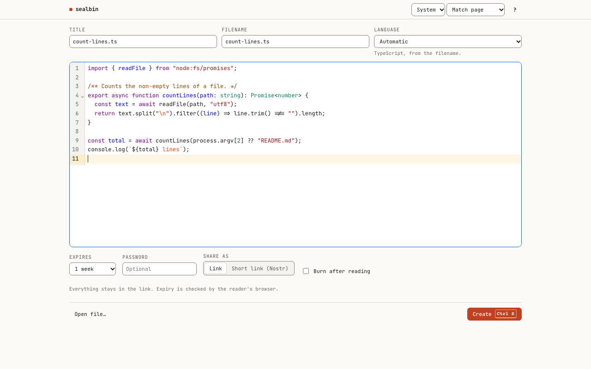
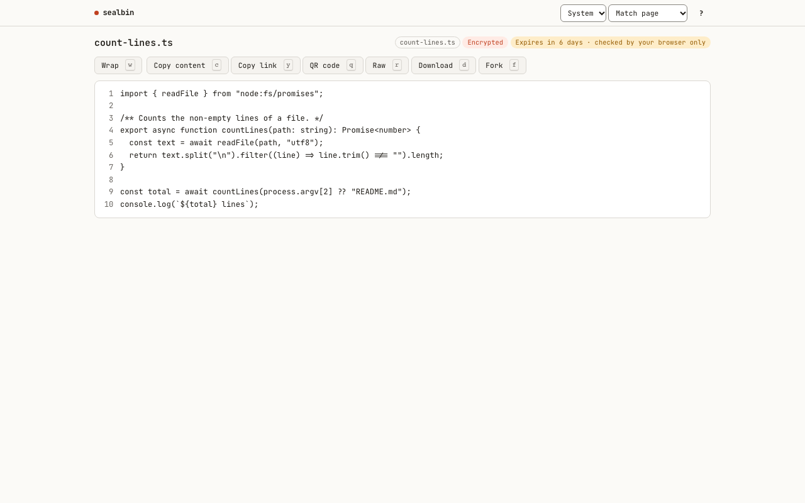
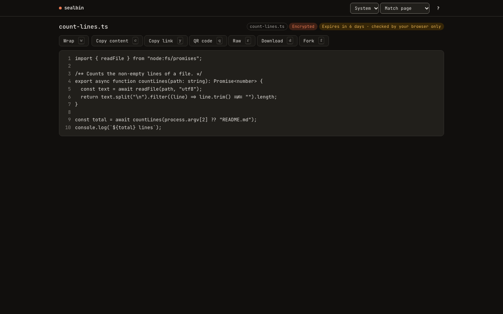
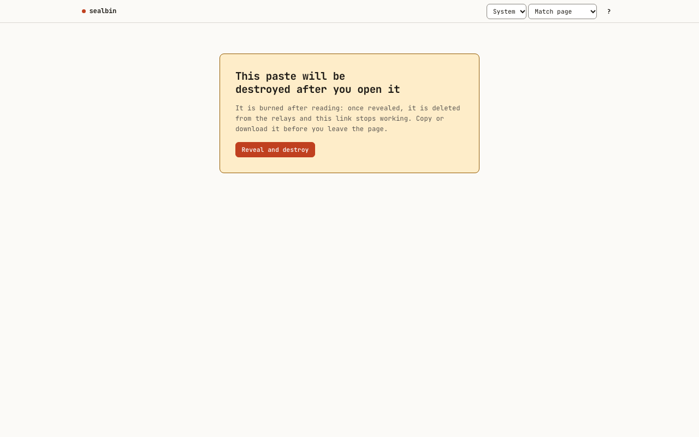

# sealbin

An end-to-end encrypted pastebin that runs entirely in your browser. There is no server: the paste is compressed and encrypted before it leaves the page, and the key lives in the part of the link after `#`, which browsers never send.

**Live:** https://maxgfr.github.io/sealbin/

| Compose | View (light) | View (dark) | Burn after reading |
| --- | --- | --- | --- |
|  |  |  |  |

## Features

- **Two storage modes.**
  - *Link*: the encrypted paste is the link. Nothing is stored anywhere and no network request is made.
  - *Short link*: the encrypted paste is published to public Nostr relays and the link carries only a 32-byte secret.
- Pastes up to 2 MiB in both modes. A long short-link paste is split into several relay events of at most 100,000 characters each, so it fits the strictest public relays (128 KiB per message). A long link works too, but some chat apps cut links over about 2,000 characters, so the composer suggests a short link past that.
- AES-256-GCM encryption with keys derived by HKDF-SHA-256; content is compressed first.
- Optional password, stretched with Argon2id and combined with the link secret.
- Expiry (NIP-40 on relays, checked client side in link mode) and burn after reading.
- A separate delete link for short-link pastes. It does not contain the read secret.
- Syntax highlighting, rendered Markdown (sanitised with DOMPurify), raw view.
- Line links: select lines and share `&L3-7`.
- QR code for links short enough to fit one.
- Light and dark themes, keyboard shortcuts, installable as a PWA with an offline app shell.
- No accounts, no analytics, no third-party requests besides the relays.

## Compared with wastebin

[matze/wastebin](https://github.com/matze/wastebin) is a good self-hosted pastebin. The two make different trade-offs:

| | sealbin | wastebin |
| --- | --- | --- |
| Hosting | Static files (GitHub Pages) | A Rust server with SQLite |
| Encryption | Always, in the browser | Optional, password-based, done on the server |
| Who can read stored pastes | Nobody without the link | The server operator (unencrypted pastes) |
| Storage | The link itself, or public Nostr relays | Your server's database |
| Deletion and expiry | Best effort (client-side check in link mode, NIP-40 and tombstones on relays) | Enforced by your server |
| Burn after reading | Yes (short-link mode) | Yes |
| Syntax highlighting | Yes | Yes |
| Self-hosting | Fork and deploy any static host | Run the binary or container |

If you need guaranteed deletion and control over storage, run wastebin. If you want encryption that does not depend on trusting a server operator and no server to maintain, sealbin fits.

## Link formats

| Fragment | Meaning |
| --- | --- |
| `#/l/<payload>` | Link-mode paste. The ciphertext and key are in the link. |
| `#/p/<payload>` | Link-mode paste protected by a password. |
| `#/n/<secret>` | Short-link paste on Nostr. 43-character base64url secret. |
| `#/d/<id+owner key>` | Delete link for a short-link paste. Cannot read it. |
| `...&L5`, `...&L3-7` | Suffix on any paste link to highlight a line or a range. |

## Trust model

In short: the JavaScript served from `maxgfr.github.io/sealbin/` is the trust anchor. Encryption protects pastes from relays and from anyone who sees stored data, not from a tampered copy of the app. Anyone holding the full link can read the paste. Relay expiry and deletion are requests that honest relays follow and others may ignore. The page ships a strict Content Security Policy and makes no requests other than to the configured relays.

Read [SECURITY.md](SECURITY.md) for the full model and its limits.

## Future idea: iroh

[iroh](https://www.iroh.computer/) could let a paste go directly from the author's browser to the reader without relays. It is not used today because:

- in the browser iroh only works through its relay servers, with no direct peer-to-peer connection, so it would swap one relay network for another;
- its WebAssembly build is not published on npm, which would mean vendoring a toolchain build;
- peer-to-peer transfer only works while the author's tab stays open, which does not fit sharing a link and closing the laptop.

It may make sense later as an optional live-share mode.

## Development

Requires [Bun](https://bun.sh).

```sh
bun install
bun run dev          # Vite dev server
bun run test         # unit tests (vitest)
bun run test:e2e     # end-to-end tests (Playwright, against a local test relay)
bun run build        # production build in dist/
bun run check-size   # bundle size budget
```

Lint and types: `bun run lint`, `bun run typecheck`.

Relays default to a set of public Nostr relays. Set `SEALBIN_RELAYS` at build time (comma-separated `wss://` URLs) to use others.

## License

MIT
